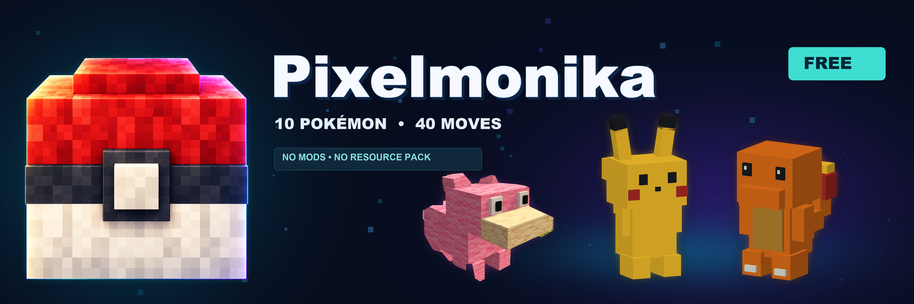
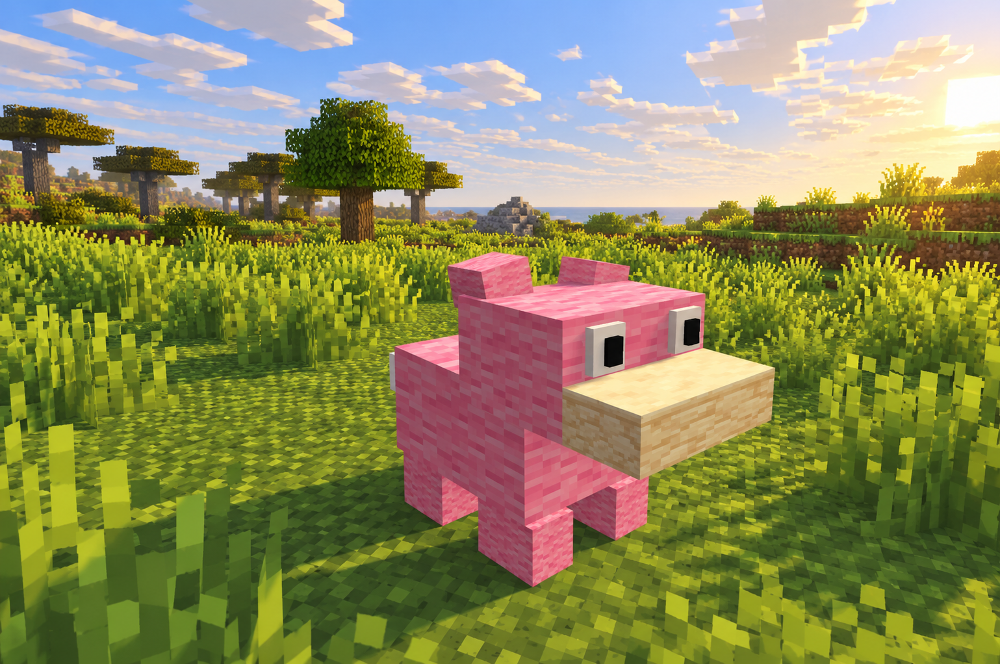
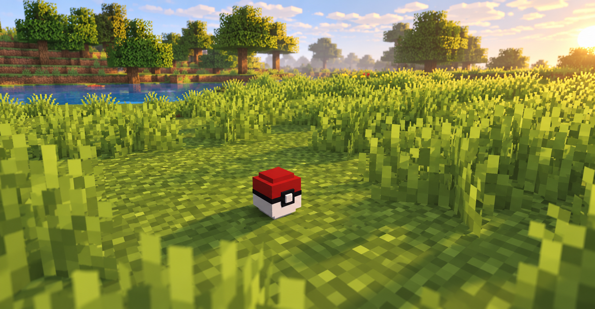
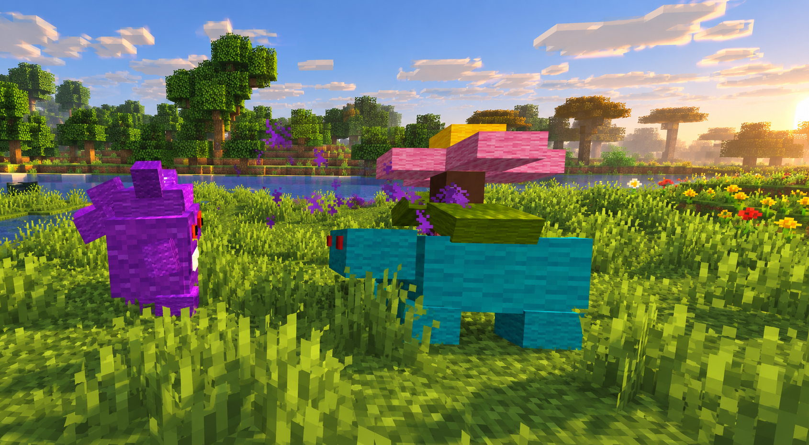

<p align="center">
  
</p>
<p align="center">
  
</p>
<h1 align="center">Pixelmonika Free</h1>
<p align="center"><strong>Explore. Catch. Battle. Build your team.</strong><br>Animated Pokémon adventures for an ordinary Minecraft Java client.</p>
<p align="center">
  <strong>10 Pokémon · 40 moves · 6 party slots · 45 PC slots</strong><br>
  Paper 26.3 · Java 25 · English / Русский · MIT source code
</p>
<p align="center">
  <a href="#getting-started">Installation</a> ·
  <a href="#how-it-plays">Mechanics</a> ·
  <a href="#commands">Commands</a> ·
  <a href="#technical-details">Technical details</a> ·
  <a href="README.ru.md">Русский</a> ·
  <a href="https://boosty.to/minefind">Premium on Boosty</a>
</p>

Pixelmonika adds animated, block-built Pokémon to your Minecraft world. Find wild encounters, choose a starter, weaken opponents in turn-based battles and catch them with a red-and-white Poké Ball. Your collection, levels and Pokédex progress are saved between sessions.

Everything runs on the server. Pokémon use Minecraft's existing block textures, display entities, particles and sounds: **players need no client mods or resource pack**. The screenshots below use optional client shaders for lighting; those shaders are not included or required.

## Meet the Free roster

| Pokémon | Type | Pokémon | Type |
| --- | --- | --- | --- |
| Pikachu | Electric | Eevee | Normal |
| Charmander | Fire | Magikarp | Water |
| Bulbasaur | Grass / Poison | Slowpoke | Water / Psychic |
| Squirtle | Water | Pidgey | Normal / Flying |
| Psyduck | Water | Vulpix | Fire |

Each species has its own block model, dimensions, base stats and four configured moves. Models animate while idle, walking, attacking, taking hits, being caught and fainting.


*Slowpoke is one of the ten species included in Free.*

## How it plays

### Choose a starter and explore

Use `/pixelmonika starter` once to choose **Charmander, Bulbasaur or Squirtle**. By default, your starter begins at level 5 and comes with 16 Poké Balls.

Wild Pokémon appear in configured worlds and biomes. Encounters respect level ranges, time windows, density and lifetime limits. Magikarp requires water; land and shore species follow their own placement rules. Natural spawning uses the world name `world` by default; edit `spawns.yml` for custom world names.

### Battle with your team

Right-click a wild Pokémon with an empty hand to open a turn-based battle. Choose a move, switch a party member, attempt a catch or flee through the inventory menu.

Damage depends on the move's power and type, the attacker's stats and the defender's stats. Type effectiveness, immunities and a same-type attack bonus apply. A Pokémon's speed plus its selected move's speed bonus determines turn order. Moves spend PP; victories award experience and can raise levels, up to level 100.

The 40 moves have species-specific names and configured power, PP, speed bonuses, colors, particle scenes and sounds. For example, Pikachu uses **Cheek Spark**, Charmander uses **Ember Flick**, and Squirtle uses **Bubble Jet**. Free's moves deal damage; status, healing and guard moves belong to Premium. These are custom server moves rather than a complete implementation of the official games' move lists.

Pokémon models are protected from ordinary Minecraft attacks. During a Pokémon battle, incoming and outgoing Minecraft combat involving its player is blocked, including interference from other players. Ordinary Minecraft PvP outside Pokémon battles follows the server's normal rules.

### Throw a Poké Ball

Use a plugin Poké Ball in the world or choose it from the battle menu. The thrown and capture animation shows a **red-and-white block-built ball**, as pictured below. In the inventory and hand, its underlying item has the vanilla snowball appearance.

Catch chance depends on the species' catch rate, remaining HP, absolute level and ball multiplier. Weakened, lower-level targets are easier to catch. Free includes the standard Poké Ball; Premium adds conditional ball types. A fainted target cannot be caught. The formula is configurable and uses custom server rules.


*The in-world ball model uses ordinary Minecraft blocks; no resource pack is needed.*

Craft four standard Poké Balls with this recipe, or view it using `/pixelmonika balls`:

| | | |
| --- | --- | --- |
| Redstone | White Wool | Redstone |
| White Wool | Snowball | White Wool |
| Redstone | White Wool | Redstone |

### Grow your collection

Keep **six Pokémon in your party** and **45 more in your PC**. Open your party with `/pixelmonika`, storage with `/pc`, and the Pokédex with `/dex`. The Free Pokédex records seen and caught species. Use `/pixelmonika heal` outside battle to restore party HP and PP; its default cooldown is 60 seconds.

## Free and Premium

Free is a playable, open-source edition with its own build. Premium is distributed separately through [Boosty](https://boosty.to/minefind).

| Feature | Free | Premium |
| --- | --- | --- |
| Pokémon / configured moves | 10 / 40 | 100 / 400 |
| Ball types | 1 standard ball | 16, with different catch conditions |
| Party / PC capacity | 6 / 45 | 6 / 180 |
| Wild encounters, catching, PvE, levels | Yes | Yes |
| Animated models and species-specific sizes / stats | Yes | Yes |
| Pokédex | Seen / caught collection | Detailed species information |
| Summoned companion following | — | Yes |
| Evolution and evolution stones | — | Yes |
| Status, healing and guard moves | — | Yes |
| Player duels and configurable arenas | — | Yes |
| World trainers / optional Citizens integration | — | Yes |
| Eight gyms and champion progression | — | Yes |
| Trading, quests and leaderboards | — | Yes |
| Pokémon Centers | — | Yes |
| English / Russian | Yes | Yes |
| Public source code | MIT | Private distribution |


***Premium preview:** Gengar and Venusaur are part of the extended roster and are not included in Free.*

[**Get Premium on Boosty →**](https://boosty.to/minefind)

## Getting started

**Current plugin version: `2.2.0-free`.**

| Requirement | Value |
| --- | --- |
| Server | Paper 26.3; compiled against `26.3.build.230-stable` |
| Java | 25 |
| Client | Minecraft Java Edition matching the server |
| Required companion plugins | None |
| Data storage | SQLite |
| Compatibility scope | Paper APIs are required; plain Spigot, Folia, Bedrock and other Minecraft versions are not supported by this release |

1. Stop your server and place **one** Free JAR in `plugins/`.
2. Choose `Pixelmonika-Free-2.2.0-spigot.jar` for the compact download, or `Pixelmonika-Free-2.2.0.jar` for a build with SQLite bundled.
3. Start Paper. The plugin creates `plugins/Pixelmonika/` and its configuration files.
4. Check the worlds in `spawns.yml`, then run `/pixelmonika starter` in game.

The compact build asks Paper to download pinned SQLite JDBC `3.50.3.0` on first startup and needs server access to Maven Central. The full build already includes it. Both have the same gameplay; install one JAR and one edition at a time. See Paper's [library loading documentation](https://docs.papermc.io/paper/dev/plugin-yml/#libraries).

### Language

English is the default. Change this in `plugins/Pixelmonika/config.yml`:

```yaml
language: ru  # en for English, ru for Russian
```

Run `/pixelmonika admin reload` outside active battles, throws and pending saves, then reopen menus. Message and move names can be edited in `messages_en.yml` and `messages_ru.yml`.

## Commands

| Command | Action |
| --- | --- |
| `/pixelmonika` | Open your party or return to your current battle |
| `/pixelmonika starter` | Choose your one-time starter |
| `/pixelmonika heal` | Restore party HP and PP outside battle |
| `/pixelmonika balls` | View the ball and crafting recipe |
| `/pixelmonika dex` or `/dex` | Open the Pokédex |
| `/pc` | Open the 45-slot PC |

Aliases: `/pokemonika`, `/creatures`, `/vm`, `/pk`.

<details>
<summary><strong>Administrator commands and permissions</strong></summary>

| Command | Action |
| --- | --- |
| `/pixelmonika admin give <player> <species> <level>` | Give a Pokémon to an online player |
| `/pixelmonika admin spawn <species> <level>` | Spawn a wild Pokémon nearby |
| `/pixelmonika admin balls <player> [poke] <amount>` | Deliver standard balls to an online player |
| `/pixelmonika admin clear` | Remove active models and end associated encounters |
| `/pixelmonika admin reload` | Validate and reload idle configuration |
| `/pixelmonika admin stats` | Inspect actor, part, battle and session counts |

Species IDs: `pikachu`, `charmander`, `bulbasaur`, `squirtle`, `eevee`, `magikarp`, `slowpoke`, `pidgey`, `psyduck`, `vulpix`. Levels: **1–100**. Ball amounts: **1–1024**.

| Permission | Default | Access |
| --- | --- | --- |
| `pixelmonika.play` | Everyone | Player commands and gameplay |
| `pixelmonika.admin` | Operators | Administration |

Legacy `pokemonika.play`, `pokemonika.admin`, `vanillamon.play` and `vanillamon.admin` remain supported. An explicit denial on a corresponding permission takes priority.

</details>

## Technical details

**Rendering:** each Pokémon is assembled from `BlockDisplay` entities, with an `Interaction` hitbox and a `TextDisplay` label. The server animates model parts and uses client interpolation. There is no client-side mod, custom texture download or required model plugin.

**Combat and data:** Pokémon HP is separate from Minecraft entity health. Battle decisions run on the main server thread; SQLite work is serialized on a dedicated worker. Player collections and operation records are stored in `vanillamon.db`. Capture and reward operations use database transactions. Base HP, Attack, Defence, Speed and Special come from Generation I reference data; moves and progression are adapted for this plugin.

**Configurable load controls:** defaults cap wild Pokémon at 20 globally and three near a player. A player sees at most 12 models within a 32-block radius. Spawn checks run every 1,200 ticks, with a 0.25 admission probability, 14-block minimum distance and 12-block minimum spacing. Unengaged wild Pokémon expire after 9,000 ticks. Effects are limited to 24 active scenes and 240 particles per tick. Tick durations assume normal 20 TPS. These are configuration limits, not a player-count or TPS guarantee.

| File / directory | Controls |
| --- | --- |
| `config.yml` | Language, limits, spawn frequency, healing, progression and catching |
| `species.yml` | Types, stats, size, catch rate and move sets |
| `moves.yml`, `types.yml` | Move power / PP / initiative and type matchups |
| `spawns.yml` | Worlds, biomes, habitats, levels and time windows |
| `models/`, `animations/`, `effects.yml` | Geometry, motion, particles and sounds |
| `balls.yml` | Standard ball appearance, catch multiplier and recipe |
| `messages_en.yml`, `messages_ru.yml` | Localized messages, names and menus |
| `vanillamon.db` | Persistent player data and operation records |

### Updating and backups

Stop the server and back up the entire plugin data folder before updating. If moving from an earlier **Free** build named Pokemonika, verify `edition: free` in its `config.yml`, then rename the backed-up `plugins/Pokemonika/` folder to `plugins/Pixelmonika/` before installing this build. Remove the old JAR. Do not import Premium databases or configurations into Free.

### Building from source

Use JDK 25 and the included Gradle wrapper:

```sh
./gradlew --no-daemon test jar spigotJar
python3 scripts/package-release.py
```

The JARs are written to `build/libs/`; the packaging script writes distribution archives, a source archive and checksums to `dist/`. Neither command starts Minecraft. Packaging includes the documentation and image assets used by this README.

## Links and support

- [Source code](https://github.com/TheViniAnd/Pokemonika) · [Report an issue](https://github.com/TheViniAnd/Pokemonika/issues)
- [Premium access on Boosty](https://boosty.to/minefind)
- [Русская документация](README.ru.md) · [SpigotMC publication kit](docs/spigot/PUBLISH.ru.md)
- [MIT license](LICENSE) · [Dependencies and data credits](THIRD_PARTY.md)

For bug reports, include the plugin version, Paper build, Java version, steps to reproduce and relevant error text. Remove personal information from logs before sharing.

Created by **TheViniAnd**. Pokémon names and referenced third-party materials retain their respective rights and notices.
