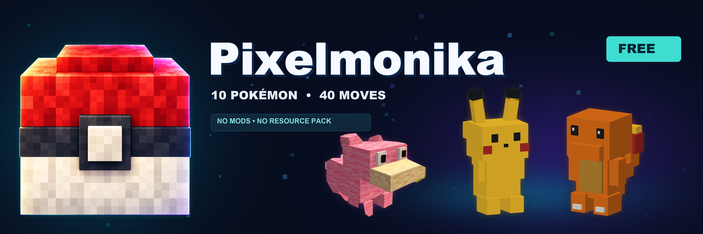
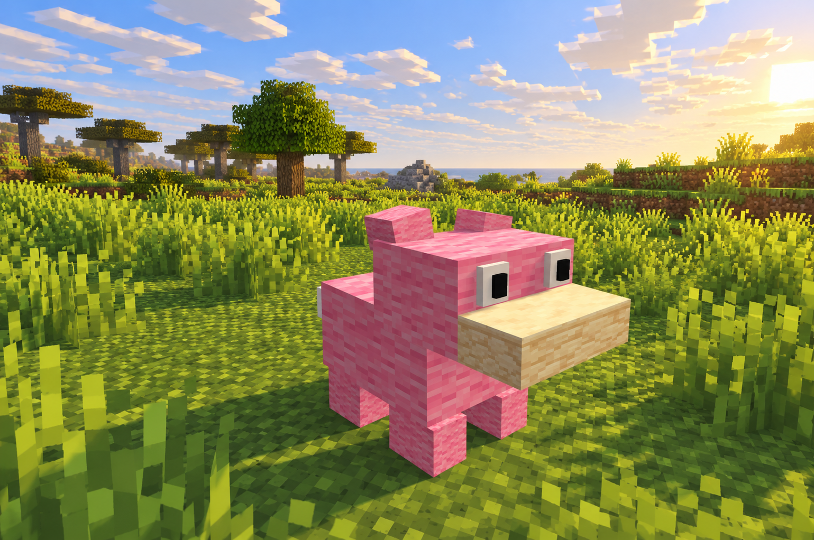
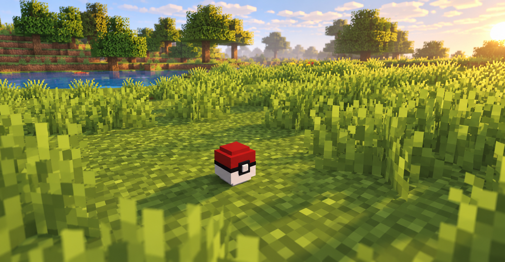
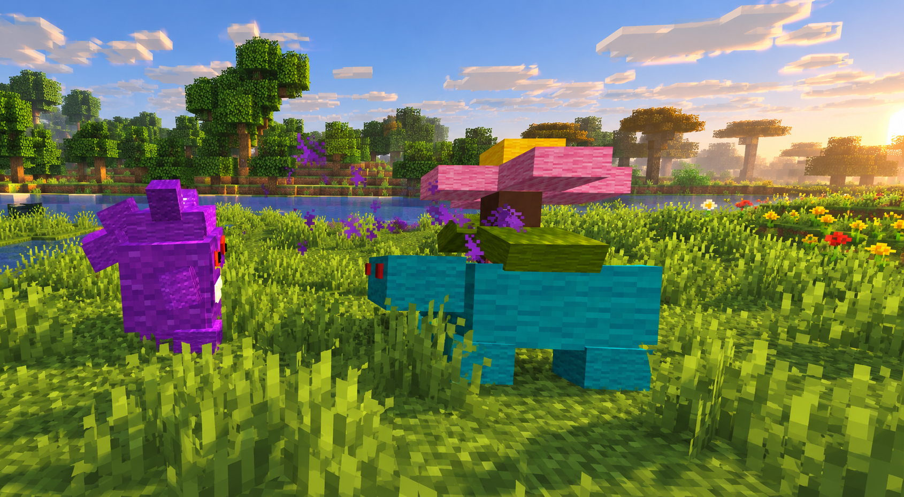

<p align="center">
  
</p>
<p align="center"></p>
<h1 align="center">Pixelmonika Free</h1>
<p align="center"><strong>Исследуй мир. Лови покемонов. Собирай команду.</strong><br>Анимированные покемоны для обычного клиента Minecraft Java Edition.</p>
<p align="center"><strong>10 покемонов · 40 приёмов · 6 мест в команде · 45 мест в ПК</strong><br>Paper 26.3 · Java 25 · English / Русский · Открытый код MIT</p>
<p align="center">
  <a href="#установка">Установка</a> · <a href="#механики">Механики</a> ·
  <a href="#команды">Команды</a> · <a href="#техническое-устройство">Техническая часть</a> ·
  <a href="README.md">English</a> · <a href="https://boosty.to/minefind">Premium на Boosty</a>
</p>

Pixelmonika добавляет в Minecraft анимированных покемонов из обычных блоков. Выбирай стартового, ищи диких существ, ослабляй их в пошаговом бою и лови красно-белым покеболом. Коллекция, уровни и прогресс покедекса сохраняются между входами.

Вся механика работает на сервере: **игрокам не нужны моды и ресурс-пак**. Модели используют стандартные текстуры Minecraft, частицы и звуки. Освещение на скриншотах создают дополнительные клиентские шейдеры; для работы плагина они не нужны и в комплект не входят.

## Покемоны Free

| Покемон | Тип | Покемон | Тип |
| --- | --- | --- | --- |
| Пикачу | Электрический | Иви | Обычный |
| Чармандер | Огненный | Мэджикарп | Водный |
| Бульбазавр | Травяной / Ядовитый | Слоупок | Водный / Психический |
| Сквиртл | Водный | Пиджи | Обычный / Летающий |
| Псайдак | Водный | Вульпикс | Огненный |

У каждого вида своя блочная модель, размеры, базовые характеристики и четыре настроенных приёма. Есть анимации ожидания, ходьбы, атаки, получения урона, поимки и поражения.


*Слоупок — один из десяти покемонов бесплатной версии.*

## Механики

### Старт и исследование

Команда `/pixelmonika starter` позволяет один раз выбрать **Чармандера, Бульбазавра или Сквиртла**. По умолчанию стартовый покемон имеет 5-й уровень, а игрок получает 16 покеболов.

Дикие покемоны появляются в заданных мирах и биомах с учётом уровня, времени суток, плотности и срока существования. Мэджикарпу нужна вода; для сухопутных и прибрежных видов действуют свои правила размещения. По умолчанию разрешён мир `world`. Для мира с другим названием измени `spawns.yml`.

### Пошаговые бои

Нажми правой кнопкой по дикому покемону с пустой рукой, чтобы начать бой. В меню можно выбрать атаку, сменить участника команды, бросить покебол или сбежать.

Урон зависит от силы и типа приёма, характеристик атакующего и защиты цели. Учитываются эффективность типов, иммунитеты и бонус за совпадение типа атаки с типом покемона. Очерёдность определяют скорость покемона и бонус скорости выбранного приёма. Атаки расходуют PP, победы дают опыт, а максимальный уровень — 100.

У 40 приёмов свои названия, сила, PP, бонусы скорости, цвета, сцены частиц и звуки. Названия и эффекты подобраны под виды. В Free все приёмы наносят урон; статусы, лечение и защитные приёмы доступны в Premium. Это авторские серверные приёмы, а не полное повторение списков атак оригинальных игр.

Модели защищены от обычных ударов Minecraft. Во время боя покемонов заблокирован обычный входящий и исходящий бой с участием игрока, включая вмешательство других игроков. Вне боя покемонов обычное PvP подчиняется настройкам сервера.

### Ловля

Бросай покебол в мире или выбирай его в боевом меню. **При полёте и поимке видна красно-белая модель из блоков**. В инвентаре и руке предмет использует стандартный внешний вид снежка.

Шанс зависит от базовой ловимости вида, оставшегося HP, абсолютного уровня и множителя покебола. Ослабленного покемона низкого уровня поймать проще. В Free есть стандартный покебол, в Premium — дополнительные типы с особыми условиями. Покемона с нулевым HP поймать нельзя. Формула настраивается и использует серверные правила.


*Модель в мире собрана из стандартных блоков и не требует ресурс-пака.*

Рецепт даёт четыре покебола. Посмотреть его в игре можно через `/pixelmonika balls`:

| | | |
| --- | --- | --- |
| Редстоун | Белая шерсть | Редстоун |
| Белая шерсть | Снежок | Белая шерсть |
| Редстоун | Белая шерсть | Редстоун |

### Команда, ПК и покедекс

В команде помещается **шесть покемонов**, в ПК — **ещё 45**. Команда открывается через `/pixelmonika`, хранилище — `/pc`, покедекс — `/dex`. Покедекс Free отмечает встреченные и пойманные виды. `/pixelmonika heal` восстанавливает HP и PP вне боя; стандартная задержка между лечениями — 60 секунд.

## Free и Premium

Free — самостоятельная игровая версия с открытым кодом. Premium распространяется отдельно через [Boosty](https://boosty.to/minefind).

| Возможность | Free | Premium |
| --- | --- | --- |
| Покемоны / настроенные приёмы | 10 / 40 | 100 / 400 |
| Типы покеболов | 1 стандартный | 16 с разными условиями поимки |
| Команда / ПК | 6 / 45 | 6 / 180 |
| Дикие встречи, ловля, PvE, уровни | Да | Да |
| Анимации, размеры и характеристики видов | Да | Да |
| Покедекс | Встреченные / пойманные | Подробная информация о видах |
| Вызов спутника, следующего за игроком | — | Да |
| Эволюции и камни эволюции | — | Да |
| Статусы, лечение и защитные приёмы | — | Да |
| Дуэли игроков и арены | — | Да |
| Тренеры в мире / необязательный Citizens | — | Да |
| Восемь гимов и чемпион | — | Да |
| Обмены, задания и таблицы лидеров | — | Да |
| Покецентры | — | Да |
| Английский / русский | Да | Да |
| Исходный код | Открытый, MIT | Закрытое распространение |


***Кадр из Premium:** Генгар и Венузавр входят в расширенный каталог и отсутствуют в Free.*

[**Купить доступ к Premium на Boosty →**](https://boosty.to/minefind)

## Установка

**Версия плагина: `2.2.0-free`.**

| Требование | Значение |
| --- | --- |
| Сервер | Paper 26.3; сборка против API `26.3.build.230-stable` |
| Java | 25 |
| Клиент | Minecraft Java Edition соответствующей версии |
| Обязательные дополнительные плагины | Нет |
| Хранение | SQLite |
| Совместимость | Нужны API Paper; обычный Spigot, Folia, Bedrock и другие версии Minecraft этой сборкой не поддерживаются |

1. Останови сервер и положи **один** JAR Free в папку `plugins/`.
2. Выбери компактный `Pixelmonika-Free-2.2.0-spigot.jar` либо `Pixelmonika-Free-2.2.0.jar` со встроенной SQLite.
3. Запусти Paper. Плагин создаст папку `plugins/Pixelmonika/` и конфигурации.
4. Проверь разрешённые миры в `spawns.yml` и выполни в игре `/pixelmonika starter`.

Компактная сборка использует загрузчик библиотек Paper: при первом запуске скачивается SQLite JDBC `3.50.3.0`, поэтому серверу нужен доступ к Maven Central. В полной сборке библиотека уже внутри. Механики у обеих одинаковые; одновременно устанавливается один JAR одной редакции. Подробнее — в [документации Paper](https://docs.papermc.io/paper/dev/plugin-yml/#libraries).

### Язык

По умолчанию включён английский. Для русского измени `plugins/Pixelmonika/config.yml`:

```yaml
language: ru  # en — английский, ru — русский
```

Выполни `/pixelmonika admin reload` вне активных боёв, бросков и незавершённых сохранений, затем открой меню заново. Тексты, названия видов и приёмов редактируются в `messages_en.yml` и `messages_ru.yml`.

## Команды

| Команда | Действие |
| --- | --- |
| `/pixelmonika` | Открыть команду или вернуться в текущий бой |
| `/pixelmonika starter` | Один раз выбрать стартового покемона |
| `/pixelmonika heal` | Восстановить HP и PP команды вне боя |
| `/pixelmonika balls` | Посмотреть покебол и рецепт |
| `/pixelmonika dex` или `/dex` | Открыть покедекс |
| `/pc` | Открыть ПК на 45 мест |

Альтернативные основные команды: `/pokemonika`, `/creatures`, `/vm`, `/pk`.

<details>
<summary><strong>Команды администратора и права</strong></summary>

| Команда | Действие |
| --- | --- |
| `/pixelmonika admin give <player> <species> <level>` | Выдать покемона игроку в сети |
| `/pixelmonika admin spawn <species> <level>` | Создать дикого покемона рядом |
| `/pixelmonika admin balls <player> [poke] <amount>` | Доставить стандартные покеболы игроку в сети |
| `/pixelmonika admin clear` | Удалить текущие модели и закончить связанные встречи |
| `/pixelmonika admin reload` | Проверить и перезагрузить свободную конфигурацию |
| `/pixelmonika admin stats` | Показать число моделей, частей, боёв и сессий |

Идентификаторы: `pikachu`, `charmander`, `bulbasaur`, `squirtle`, `eevee`, `magikarp`, `slowpoke`, `pidgey`, `psyduck`, `vulpix`. Уровни: **1–100**. Число выдаваемых покеболов: **1–1024**.

| Право | По умолчанию | Доступ |
| --- | --- | --- |
| `pixelmonika.play` | Все игроки | Игровые команды и механики |
| `pixelmonika.admin` | Операторы | Администрирование |

Старые права `pokemonika.play`, `pokemonika.admin`, `vanillamon.play` и `vanillamon.admin` поддерживаются. Явный запрет соответствующего права имеет приоритет.

</details>

## Техническое устройство

**Отображение:** покемон состоит из сущностей `BlockDisplay`, области взаимодействия `Interaction` и подписи `TextDisplay`. Сервер меняет положения частей модели, а клиент сглаживает движение. Отдельный мод, загрузка текстур и обязательный плагин моделей не нужны.

**Бои и данные:** HP покемонов хранится отдельно от здоровья сущностей Minecraft. Игровая логика выполняется в основном потоке сервера; SQLite обрабатывается последовательно в отдельном рабочем потоке. Коллекции и записи операций находятся в `vanillamon.db`; выдача наград и поимка используют транзакции. Базовые HP, атака, защита, скорость и Special взяты из данных первого поколения; приёмы и развитие адаптированы под плагин.

**Ограничения нагрузки:** по умолчанию допускается 20 диких покемонов глобально и три рядом с игроком. Игрок видит до 12 моделей в радиусе 32 блоков. Проверка спавна проходит каждые 1 200 тиков с вероятностью допуска 0,25; минимальная дистанция до игрока — 14 блоков, между дикими покемонами — 12. Свободные дикие покемоны исчезают через 9 000 тиков. Эффекты ограничены 24 активными сценами и 240 частицами за тик. Время в тиках зависит от фактического TPS. Это настройки ограничений, а не обещание конкретного онлайна или производительности.

| Файл / папка | Назначение |
| --- | --- |
| `config.yml` | Язык, лимиты, частота спавна, лечение, развитие и ловля |
| `species.yml` | Типы, характеристики, размеры, ловимость и наборы приёмов |
| `moves.yml`, `types.yml` | Сила, PP, очерёдность и взаимодействие типов |
| `spawns.yml` | Миры, биомы, среда обитания, уровни и время суток |
| `models/`, `animations/`, `effects.yml` | Геометрия, движения, частицы и звуки |
| `balls.yml` | Внешний вид, множитель ловли и рецепт покебола |
| `messages_en.yml`, `messages_ru.yml` | Сообщения, названия и меню |
| `vanillamon.db` | Постоянные данные игроков и записи операций |

### Обновление и резервные копии

Перед обновлением останови сервер и скопируй всю папку данных плагина. При переходе со старой **Free** под названием Pokemonika проверь `edition: free` в её `config.yml`, затем после резервного копирования переименуй `plugins/Pokemonika/` в `plugins/Pixelmonika/`. Удали старый JAR. Базу и конфигурацию Premium в Free переносить нельзя.

### Сборка из исходников

Нужны JDK 25 и включённый Gradle wrapper:

```sh
./gradlew --no-daemon test jar spigotJar
python3 scripts/package-release.py
```

JAR появятся в `build/libs/`; упаковщик создаёт архивы, архив исходников и контрольные суммы в `dist/`. Эти команды не запускают Minecraft. Документация и картинки README входят в архивы.

## Ссылки и поддержка

- [Исходный код](https://github.com/TheViniAnd/Pokemonika) · [Сообщить об ошибке](https://github.com/TheViniAnd/Pokemonika/issues)
- [Доступ к Premium на Boosty](https://boosty.to/minefind)
- [English documentation](README.md) · [Материалы для SpigotMC](docs/spigot/PUBLISH.ru.md)
- [Лицензия MIT](LICENSE) · [Библиотеки и источники данных](THIRD_PARTY.md)

Для сообщения об ошибке приложи версию плагина, сборку Paper, версию Java, шаги воспроизведения и текст ошибки. Перед отправкой убери личные данные из логов.

Автор — **TheViniAnd**. Названия Pokémon и сторонние материалы сохраняют права и уведомления соответствующих владельцев.
